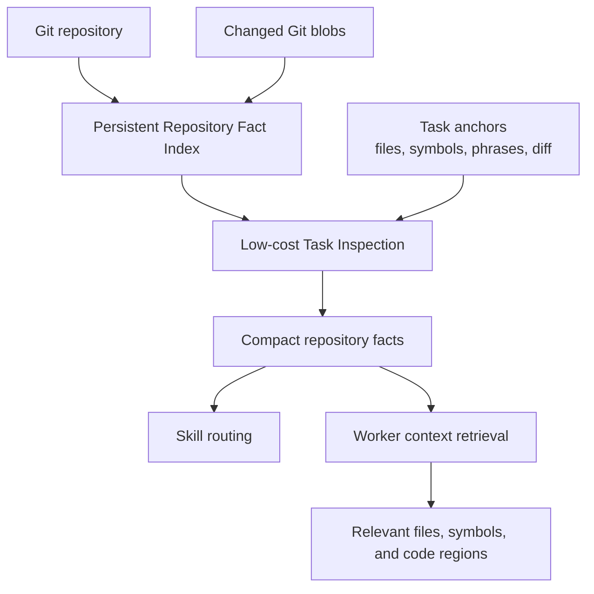

# Repository Inspection

Repository inspection gives Agent CLI a cheap, reusable understanding of a codebase.

It exists so the CLI does not repeatedly spend model tokens rereading the same repository.

## Plain-English version

Think of the repository index as a **map and table of contents for the codebase**.

The first time Agent CLI opens a repository, it records useful facts such as:

- what files exist
- which files look like tests, migrations, CI, deployment, config, or dependency files
- what languages and frameworks appear
- important functions, classes, and exported symbols
- imports and obvious relationships between files
- where exact names and strings occur

After that, it should update only what changed.

When a new task arrives, Agent CLI starts from small clues such as a filename, symbol, package, or task phrase. It uses the cached repository map to find the small part of the codebase that matters.

The goal is:

> Use code structure first. Spend model tokens only when structure is not enough.

## Why there are two levels

Repository inspection serves two different jobs.

### 1. Routing inspection

Skill routing needs small facts such as:

- this touches an HTTP API
- this touches authentication
- this changes persistence
- this modifies deployment
- this uses retries

These facts should be very cheap to obtain.

### 2. Worker retrieval

An implementer or reviewer may later need deeper context such as:

- where a function is defined
- what calls it
- which tests cover it
- what nearby code is relevant
- which exact lines should be read

That deeper retrieval can cost more because it directly supports implementation or review.

Do not use the heavy worker-retrieval path just to decide which skills to load.

## Flow



## Core idea: index once, reuse often

Repository analysis is cached by:

`git blob SHA + analyzer version`

A Git blob SHA identifies file contents. If the same contents appear in another branch or worktree, Agent CLI can reuse the analysis.

### Example

Suppose a repository has 1,000 tracked files.

A feature branch changes 3 of them.

Agent CLI should:

- reuse cached analysis for the 997 unchanged files
- analyze only the 3 changed blobs
- update relationships affected by those changes

It should not rescan all 1,000 files.

This is especially useful because Agent CLI uses Git worktrees. Different workers can reuse analysis for identical file contents.

## What the index stores

The exact schema is an implementation detail, but V1 should preserve facts useful for routing and retrieval.

### File facts

Examples:

- path
- language
- size
- test file?
- generated or vendored?
- config?
- migration?
- CI?
- deployment?
- dependency manifest?

### Code structure

Where supported:

- functions
- classes
- methods
- exported/public symbols
- imports
- obvious definitions and references

### Relationships

Examples:

- file A imports file B
- function A calls or references symbol B
- test file X covers package Y
- route file uses service Z

The graph is stored for lookup. The whole graph should not be sent to a model.

### Search data

Keep lexical/full-text search.

Exact identifiers, error strings, config keys, and dependency names are often more useful than semantic search.

## Use the cheapest source first

Agent CLI should move from cheap evidence to expensive evidence only when needed:

1. path and file metadata
2. manifests and config
3. parsed code structure
4. exact/full-text search
5. precise language-tool relationships when available
6. cached semantic summaries or embeddings when useful
7. agentic exploration only for hard worker tasks

This order is intentional.

A migration filename can tell us a task touches migrations without any model call.

A symbol definition can tell us where code lives without semantic search.

Only ambiguous meaning should require a model.

## V1 technology direction

V1 should favor simple local tools:

- **Git** for tracked files, content hashes, and changed blobs
- **SQLite** for persistent facts and relationships
- **SQLite FTS5** or equivalent for full-text search
- **Tree-sitter** or equivalent for multi-language structural parsing
- **ripgrep** as a fast exact-search fallback
- optional language-server or SCIP-style adapters for more precise references

A vector database is not required for V1.

Semantic retrieval can be added later without replacing the structural index.

## Task inspection

The persistent index describes the repository.

**Task inspection** finds the small part of that index relevant to the current subtask.

Start from anchors such as:

- files named by the task or specification
- symbols named by the task
- files currently changed
- exact identifier matches
- lexical matches
- relevant package or service
- direct dependencies
- related tests

Then expand only as needed.

### Example

Task:

> Add expiration support to SessionCache without changing existing callers.

Useful initial anchors may be:

- `SessionCache`
- files defining that symbol
- files that call it
- tests referencing it

Agent CLI should inspect that neighborhood before searching unrelated areas.

## Task-specific graph, not whole-repository graph

The repository can contain a large relationship graph.

For a task, build a small neighborhood around the strongest anchors.

Conceptually:

```text
task
 ↓
seed files/symbols
 ↓
direct neighbors
 ↓
rank
 ↓
expand only strong candidates if needed
```

Do not serialize the full repository graph into model context.

## Ranking relevant context

Context candidates should receive stronger scores when they are directly connected to the task.

For example:

```text
explicit file named          very strong
explicit symbol named        very strong
currently changed file       strong
exact identifier match       strong
direct dependency/caller     strong
related test                 strong
lexical match                medium
semantic similarity          fallback/medium
distant graph neighbor       weak
```

The exact weights belong in implementation/evaluation, not in this document.

The principle is to prefer **direct evidence** over vague similarity.

## Prefer code regions over whole files

For worker retrieval, the best unit is often:

```text
file → symbol → relevant region
```

rather than the whole file.

If Agent CLI knows the task concerns `SessionCache.get()`, it should be able to supply that symbol and nearby relevant code instead of a 1,000-line file.

Whole-file retrieval remains a fallback when structure is unavailable or the file is small.

## Optional cached summaries

A future optimization may store a compact summary for a file or module.

Example:

```yaml
purpose: Manages authentication sessions and refresh-token lifecycle.
exposes:
  - create_session
  - refresh_session
  - revoke_session
depends_on:
  - SessionRepository
  - TokenSigner
tested_by:
  - tests/session/test_service.py
```

If generated by a model, the summary MUST be cached by blob SHA and treated as derived context, not source truth.

The underlying source and structural index remain authoritative.

## Facts need provenance

Agent CLI should record how a repository fact was learned.

At minimum:

- `structural` — derived directly from files, Git, manifests, parser output, or exact search
- `semantic` — inferred by a classifier/model
- `worker_discovered` — discovered during task execution

Example:

```yaml
fact: migration
source: structural
evidence: migrations/20261030_add_session.sql
```

Structural evidence should generally outrank semantic inference when they conflict.

## Cold start vs warm update

### Cold start

The first repository index may do more work:

```text
git ls-files
→ classify paths/manifests
→ parse supported files
→ extract symbols/relationships
→ build lexical index
→ persist facts
```

### Warm update

Normal use should be much cheaper:

```text
find changed blobs
→ analyze changed content only
→ update affected relationships
→ reuse everything else
```

Warm updates are the common path and should be optimized heavily.

## How this connects to skill routing

Repository inspection should produce compact facts, not skill names.

Example:

```yaml
affected_surfaces:
  - api
  - session_store

structural_facts:
  - http_api
  - database

symbols:
  - SessionService.refresh
  - refresh_token_route
```

The low-cost skill-routing classifier then handles only ambiguous semantic classification.

See [SKILL_ROUTING.md](SKILL_ROUTING.md).

## How misses improve the system

A failure should be assigned to the layer that caused it.

### Inspection miss

The repository contained clear structural evidence, but inspection failed to extract it.

Fix the indexer/extractor and add an inspection regression case.

### Semantic miss

The compact repository/task facts were correct, but the cheap classifier missed the meaning.

Improve the classifier prompt/model or signal examples and add a routing regression case.

### Routing-policy miss

The correct signal existed, but the routing policy mapped it to the wrong skills.

Fix the routing policy and add a routing-policy regression case.

### Skill-content miss

The correct skill loaded, but its guidance was incomplete.

Improve the skill and add a skill-behavior regression case.

Keeping these categories separate prevents every failure from becoming "the model was wrong."

## Metrics

Optimize for useful context per unit of cost.

Useful measurements include:

- cold-index duration
- warm-update duration
- number of changed blobs analyzed
- cache reuse rate
- task-inspection latency
- structural facts produced
- semantic fallbacks required
- relevant file/symbol recall in evaluations
- worker context tokens produced
- routing escalations caused by inspection misses

Do not optimize for the smallest individual response if doing so causes more searches or model calls later.

## V1 boundaries

V1 should include:

- persistent local fact index
- Git-based incremental updates
- path/manifests classification
- structural parsing for supported languages
- lexical search
- basic relationships
- provenance
- compact task-specific inspection

V1 does not require:

- a vector database
- embeddings for every file
- generated summaries for every file
- perfect call graphs
- compiler-grade analysis for every language
- an agent that explores the repository just to choose skills

Those can be added when evaluation shows they pay for their complexity.
