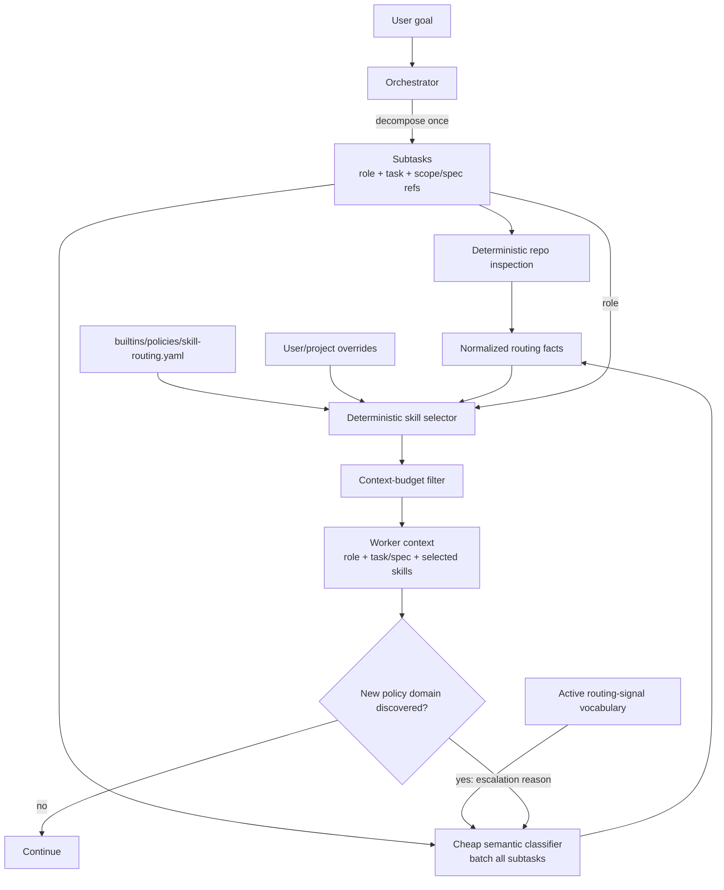

# Skill Routing

Skill routing selects the minimum policy context required for one worker subtask.

It is separate from role assignment and from model/provider/harness routing.

## Design

A role defines authority. Skills provide policy or knowledge. Adding a skill never expands role authority.

The orchestrator does **not** choose skill names and does not need skill bodies in its prompt.

Instead:

1. The orchestrator decomposes the request and assigns each subtask a role.
2. Repository inspection reads cached structural facts from the Repository Fact Index; see [REPOSITORY_INSPECTION.md](REPOSITORY_INSPECTION.md).
3. One cheap System-1-style classifier batches the subtasks and maps their compact context to normalized routing signals.
4. Deterministic code maps role defaults and signals to skills.
5. Only selected `SKILL.md` bodies enter worker context.

The classifier is intentionally optimized for cost and latency rather than maximum accuracy. Misses are recovered through dynamic escalation and become routing-evaluation cases.

## Flow



## Why a cheap classifier

The fuzzy part of routing is semantic classification, not policy selection.

A small, low-cost model is sufficient to answer questions such as:

- does this task touch authentication?
- is this a schema or migration change?
- is this primarily research?
- does this change deployment behavior?

The expensive orchestrator should spend reasoning on decomposition, ambiguity, and decisions—not on selecting skill files.

The classifier MUST:

- use the cheapest configured model that meets the routing-classification floor
- batch all new or changed subtasks from one orchestration cycle into one call when practical
- receive only compact subtask context and the active signal vocabulary
- return only normalized signal IDs plus optional brief evidence
- have a small output budget
- never directly choose skills
- never change role authority

If the classifier is unavailable or exceeds its budget, routing falls back to role defaults plus deterministic repository facts. It MUST NOT automatically escalate to an expensive model solely to improve skill selection.

## Inputs

The classifier receives only what it needs:

- subtask ID
- assigned role
- concise task statement
- concise approved-spec summary or reference facts, when applicable
- affected repository surfaces already identified
- active normalized signal vocabulary

It does not receive:

- skill bodies
- full conversation history
- unrelated repository content
- model/provider/harness catalogs
- routing rules that do not affect signal classification

## Signals

A signal is a normalized semantic fact about what the work touches.

Examples:

- `http_api`
- `authentication`
- `schema`
- `retry`
- `latency`
- `deployment`

Signals are not literal prompt keywords and are not skill names.

The signal vocabulary comes from the effective routing policy. The classifier emits only values from that vocabulary.

The Repository Fact Index SHOULD derive signals without a model when structural evidence is clear. Examples:

- migration files -> `migration`
- HTTP route definitions -> `http_api`
- CI workflow files -> `ci_cd`
- dependency manifests -> `dependency_change`

Model and deterministic facts are unioned before skill selection.

## Selection

The skill selector is ordinary deterministic code.

For each subtask it:

1. loads `role_defaults[role]`
2. adds skills whose configured signals match detected routing facts
3. applies user/project/session/task overrides
4. resolves same-name skill source precedence
5. applies the context budget
6. records the decision
7. loads only the selected skill bodies

The selector never asks a model which skills to load.

## Example

Request:

> Add a refresh-token endpoint backed by the existing session store.

The orchestrator may create:

```yaml
id: refresh-token
role: implementer
task: Add a refresh-token endpoint using the existing session store.
affected_surfaces:
  - api
  - session_store
```

The cheap classifier may return:

```yaml
id: refresh-token
signals:
  - http_api
  - authentication
  - authorization
  - external_input
  - database
  - request_path
```

The implementer role defaults are:

```text
software-engineering
testing
```

Signal matching adds:

```text
interfaces
security
data
observability
```

Only those skill bodies are loaded for the implementer.

A pure research subtask can instead receive the `research_investigator` role and only the `research` baseline skill unless other signals justify more context.

## Dynamic escalation

Initial routing is allowed to be incomplete.

If a worker discovers an uncovered policy domain:

1. the worker reports the new fact in ordinary language with evidence
2. the orchestrator records the new task/repository fact
3. the cheap classifier reclassifies only the changed subtask, unless deterministic logic can derive the signal directly
4. deterministic skill selection runs again
5. newly selected skill content is injected
6. the escalation and reason are recorded

The worker keeps the same role authority and approved scope.

## Learning loop

Routing quality improves independently from worker quality.

Persist:

- classifier model/version
- classifier input version
- emitted signals
- deterministic signals
- selected skills
- dynamic escalations
- reviewer corrections attributable to missing policy
- dropped skills and budget reasons

A dynamic escalation caused by a missed domain is a candidate routing-regression case.

The routing golden set evaluates:

> Given this compact subtask context, which normalized signals and skills were required?

This lets Agent CLI replace the cheap classifier with better low-cost models over time without changing orchestration or skill policy.

## Token-efficiency rules

1. Do not use the expensive orchestrator to select skill files.
2. Do not make one classifier call per skill.
3. Batch subtasks when practical.
4. Do not send skill bodies to the classifier.
5. Send the signal vocabulary, not verbose skill descriptions.
6. Derive obvious repository facts without a model.
7. Load skill bodies only after deterministic selection.
8. Reclassify only changed subtasks during escalation.
9. Do not use an expensive fallback solely for skill-routing accuracy.
